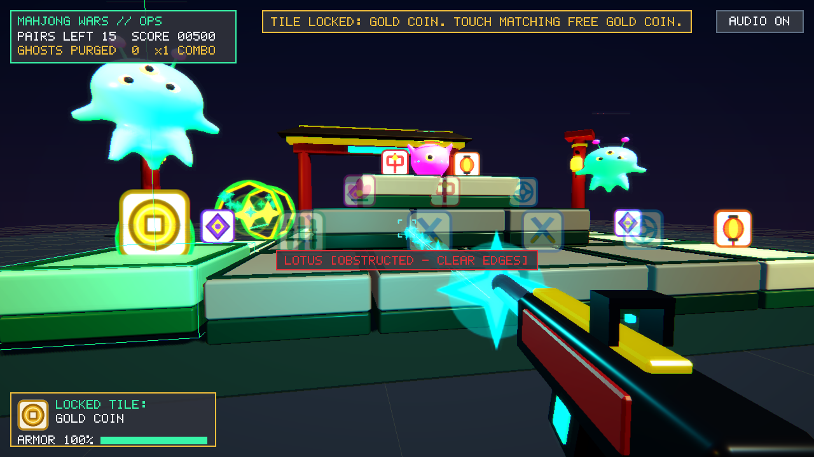

# Dullahan Framework

A **zero-dependency, flat, hot-reloadable, LLM-first Rust game framework** (Linux-first) built for sub-second iteration, Git-friendly data-driven design, and closed-loop visual/state verification.


> **Status:** Active dogfooding showcase — built with **0 external Cargo crates** (`[dependencies]` is empty).

---

## Showcase Demos

All showcase games live in clean, self-contained subfolders under `demos/` and depend solely on `dullahan = { path = "../.." }` (**0 external crates**).

### 1. NEON RUSH (Synthwave Cyber-Runner)

A juiced-up Synthwave endless cyber-runner dogfooding 3D PBR, shadows, hot-reloadable bloom/chromatic aberration, seamless procedural synthwave audio, and pure-Rust SVG UI:

- **3D PBR + Shadows + Post-Processing:** Shared 0.94 KB PBR palette across 11 `.glb` models, 2048×2048 PCF shadows, dynamic hoverboard/headlight point lights, twilight sky gradient, translucent orbital Holo-Shield, and a custom hot-reloadable synthwave bloom + radial chromatic aberration shader (`demos/neon_rush/assets/shaders/post.frag`).
- **Gameplay & Juice:** 3-lane cyber-highway with launch ramps onto train roofs, oncoming cyber-trains, low plasma barriers, slide-under laser gates, coyote time + jump buffering + fast-fall slam, near-miss callouts (`CLOSE CALL! +50`), camera roll/shake/FOV kick, hitstop, and 3D billboard particle bursts.
- **Procedural Synthwave Audio:** Seamless 124 BPM synthwave loop (`seam=0.0001`) + 7 synth SFX mixed on a 48 kHz lock-free ALSA thread.
- **Controls:** `A`/`D` lanes · `W`/`Space` jump · `S` slide/slam · `M` mute · `F1` debug overlays · `R` restart.

---

### 2. MAHJONG WARS (Deadpan Tactical FPS Mahjong Shooter)



> *Department of Paranormal Tile Operations — Directive 404: Clear all 16 Mahjong Solitaire pairs in legal edge order. Ignore alien ectoplasmic protests.*

- **First-Person Combat + Solitaire Rules:** Run & jump across a giant 3-layer 100%-solvable 3D Mahjong pyramid (`demos/mahjong_wars/`) with native X11 FPS mouse lock (`app.set_cursor_locked`), walkable tile step-up collision, and a first-person laser carbine viewmodel with recoil & luminous plasma bolts.
- **Weird Alien Ghosts & SVG VFX:** SDF-sculpted floating three-eyed alien ghosts & psychic haloed wardens animated with squash & stretch, dynamic world-space HP bars, 8 color-coded SVG Mahjong tile emblems, SVG dynamic reticle, star muzzle flash, alien ectoplasm pop rings, and expanding **Jade & Gold Chinese Talisman Shockwave Seals** (`seal.svg`) that blast nearby ghosts when a pair matches!
- **Chinese Pentatonic War Music:** Seamless D-major pentatonic Guzheng + Erhu + Taiko war drums + woodblock loop (`seam=0.0003`) + bronze gong match chime and 6 tactical SFX.
- **Controls:** `WASD` move · `Mouse` look (click to lock, `Esc` to unlock) · `Space` jump · `LMB`/`F` laser rifle · `E`/`RMB` touch free Mahjong tile · `M` mute · `F1` debug overlays.

---

## Why Dullahan?

- **Zero Cargo dependencies:** Pure Rust + minimal `extern "C"` Linux OS FFI (`libX11`, `libGL`, `libEGL`, `libasound`). Clean builds in **~1.1s**, incremental rebuilds in **~0.25s**, zero crate API drift.
- **Flat, explicit, non-constraining:** The game owns `fn main()`, the loop, and one flat `GameState` backed by plain `Vec`s or generational `Pool<T>` arenas. No forced ECS, OOP scene graph, or monolithic physics engine.
- **Standard formats only:** Pure-Rust loaders for `.glb`/`.gltf` (PBR + named child nodes + `col` colliders), `.png` (8-bit & 16-bit heightmaps + PNG encoder), `.svg` (4×4 AA rasterizer), `.wav`, and `.glsl`. Works with Dullahan Artisan or any external assets.
- **Git-friendly data & 3-tier live iteration:**
  1. **Assets & shaders** (`.glb`, `.png`, `.svg`, `.wav`, `pbr.vert/.frag`, `post.frag`) hot-reload live in-place with safe error fallbacks.
  2. **Tuning, tables & levels** (`data/runner.cfg`, `.tbl`, `.lvl`) hot-reload live with 1-line Git diffs.
  3. **Rust logic** uses sub-second rebuild + schema-tolerant plaintext state snapshots (`./scripts/fast_restart.sh`) instead of fragile `dlopen`.
- **Closed-loop runtime verification (zero MCP):** Control and inspect live or `--headless` runs via the tiny `dctl` Unix-socket CLI.

---

## Quick Start (Linux)

```bash
# Run framework unit tests (0 external crates)
cargo test --workspace

# Play the showcase demos (each lives in its own clean folder under demos/)
cargo run -p neon_rush
cargo run -p mahjong_wars

# Live-tweak & inspect from another terminal while playing:
cargo run --bin dctl -- state
cargo run --bin dctl -- set post.bloom 0.9
cargo run --bin dctl -- set player.jump_vel 17.0
cargo run --bin dctl -- overlay colliders
cargo run --bin dctl -- screenshot /tmp/live.png

# Headless deterministic render (works without X11 / DISPLAY):
cargo run -p neon_rush -- --headless --size 1280x720 --frames 15 --snap /tmp/neon.png
cargo run -p mahjong_wars -- --headless --size 1280x720 --frames 14 --snap /tmp/mahjong.png
```

## Repository Layout

```text
DullahanFramework/
├── Cargo.toml                     # Workspace root + zero-dep `dullahan` library & `dctl` CLI
├── src/
│   ├── lib.rs                     # Library entry point
│   ├── dullahan/                  # Vendored framework core (copy directly into any game!)
│   └── bin/dctl.rs                # Closed-loop runtime control CLI
├── demos/
│   ├── neon_rush/                 # Showcase #1: Synthwave endless cyber-runner
│   └── mahjong_wars/              # Showcase #2: Deadpan FPS Mahjong Solitaire shooter
│       ├── Cargo.toml             # `dullahan = { path = "../.." }`
│       ├── src/                   # Flat `game.rs` + `main.rs`
│       ├── assets/                # .glb, .png, .svg, .wav, post.frag
│       ├── assets_src/            # Plaintext Artisan .pal/.mdl/.sfx sources
│       └── data/                  # *.cfg live tuning
├── skills/dullahan-framework/     # Companion generic LLM skill (SKILL.md)
└── scripts/fast_restart.sh        # Tier 3 sub-second snapshot-preserving restart
```

## Documentation

- [ARCHITECTURE.md](ARCHITECTURE.md) — Full framework specification, module boundaries, and format contracts.
- [skills/dullahan-framework/SKILL.md](skills/dullahan-framework/SKILL.md) — Companion generic LLM skill for building & verifying games on Dullahan.
