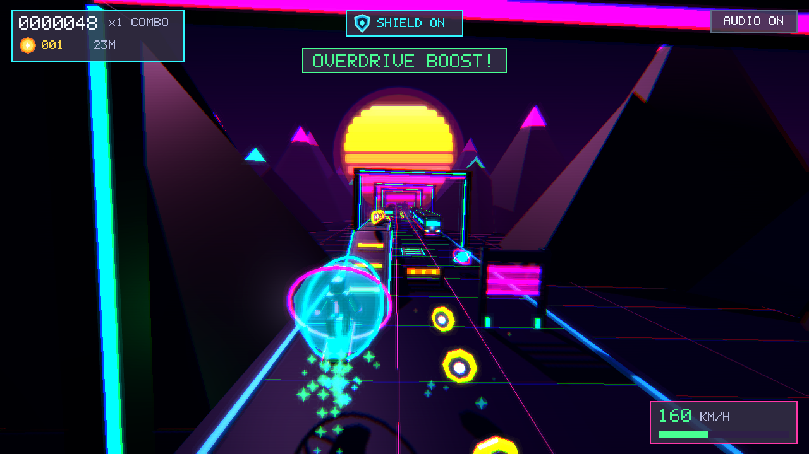
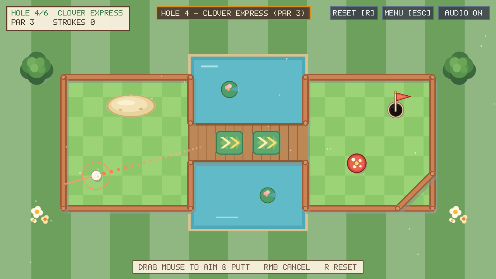

# Dullahan Framework

A **zero-dependency, flat, hot-reloadable, LLM-first Rust game framework** (Linux & Windows) built for sub-second iteration, Git-friendly data-driven design, and closed-loop visual/state verification.

> **Early Version:** Dullahan Framework is in an early, actively evolving stage. APIs and module layouts may change as features mature. Built with **0 external Cargo crates** (`[dependencies]` is empty).

---

## Showcase Demos

All showcase games live in self-contained subfolders under `demos/` and depend solely on `dullahan = { path = "../.." }` (**0 external crates**). All 3D models, shared PBR palettes, procedural music, sound effects, and SVG assets across these demos were created with **[Dullahan Artisan](https://github.com/jayzone80/DullahanArtisan)** (loaded directly at runtime as standard `.glb`, `.png`, `.wav`, and `.svg` files).

### 1. NEON RUSH (Synthwave Cyber-Runner)



A Synthwave endless cyber-runner showcasing 3D PBR, shadows, hot-reloadable bloom/chromatic aberration, seamless procedural synthwave audio, and pure-Rust SVG UI:

- **3D PBR + Shadows + Post-Processing:** Shared 0.94 KB PBR palette across 11 `.glb` models, 2048×2048 PCF shadows, dynamic hoverboard/headlight point lights, twilight sky gradient, translucent orbital Holo-Shield, and a custom hot-reloadable synthwave bloom + radial chromatic aberration shader (`demos/neon_rush/assets/shaders/post.frag`).
- **Gameplay & Juice:** 3-lane cyber-highway with launch ramps onto train roofs, oncoming cyber-trains, low plasma barriers, slide-under laser gates, coyote time + jump buffering + fast-fall slam, near-miss callouts (`CLOSE CALL! +50`), camera roll/shake/FOV kick, hitstop, and 3D billboard particle bursts.
- **Procedural Synthwave Audio:** Seamless 124 BPM synthwave loop (`seam=0.0001`) + 7 synth SFX mixed on a 48 kHz stereo audio thread (ALSA on Linux, WinMM on Windows).
- **Controls:** `A`/`D` lanes · `W`/`Space` jump · `S` slide/slam · `M` mute · `F1` debug overlays · `R` restart.

---

### 2. MAHJONG WARS (Tactical FPS Mahjong Shooter)


> *Department of Paranormal Tile Operations — Directive 404: Climb the tower. Clear all 16 Mahjong Solitaire pairs in legal edge order. Ignore alien ectoplasmic protests.*

- **First-Person Parkour + Solitaire Rules:** Climb, jump, **power-slide (`Shift`/`C`/`Ctrl`)**, and **slide-jump vault** across a giant 3-layer 100%-solvable 3D Mahjong pyramid (`demos/mahjong_wars/`) with 1:1 FPS mouse lock (`app.set_cursor_locked`), tile-edge auto-mantle, camera roll + FOV kick, and a canted laser carbine viewmodel.
- **Painted Tile Emblems, Alien Ghosts & SVG VFX:** 8 color-coded SVG Mahjong symbols painted **flat onto the 3D tile faces** (`draw.decal_flat`) so you must climb and parkour over the tower to spot pairs, SDF-sculpted floating alien ghosts with squash & stretch + world-space HP bars, SVG reticle/muzzle flash/ecto rings, and expanding **Jade & Gold Chinese Talisman Shockwave Seals** (`seal.svg`).
- **Pause & Settings Menu (`Esc`):** Interactive zero-dependency `ui_slider` calibration for Mouse Sensitivity, Master Volume, Field of View, Invert Y, and Audio Mute.
- **Chinese Pentatonic War Music:** Seamless D-major pentatonic Guzheng + Erhu + Taiko war drums + woodblock loop (`seam=0.0003`) + bronze gong match chime and 6 tactical SFX.
- **Controls:** `WASD` move · `Mouse` look · `Space` jump / slide-vault · `Shift`/`C`/`Ctrl` parkour slide · `LMB`/`F` laser rifle · `E`/`RMB` touch free Mahjong tile · `Esc` pause & settings · `M` mute · `F1` debug overlays.

---

### 3. COZY GOLF (2D Garden Mini Golf)



A warm, sunlit 6-hole 2D mini golf stroll showcasing Dullahan's pure-2D pipeline (`Camera2D`, rotated 2D sprites/rects/lines, 4×4 anti-aliased SVG art, and 2D physics):

- **Pure 2D Storybook Visuals:** Mowed checkerboard turf, terracotta-trimmed walls, turquoise lotus ponds with wooden bridges, golden sand bunkers, bouncy spotted toadstools, rotating wooden windmill paddles, clover boost pads, swaying meadow trees & wildflowers, and drifting sunlit pollen motes.
- **Tactile Slingshot Aiming & Sub-Stepped 2D Physics:** Click and drag anywhere to aim and charge putts with a live 1-bounce predicted trajectory preview, 8× sub-stepped circle-vs-segment/bumper/windmill collision, smooth cup-lip capture, and water-hazard splashes.
- **Warm Acoustic Audio & Scorecard:** Seamless 96 BPM F-major kalimba & nylon-guitar meadow loop (`seam=0.0001`) + 7 cozy foley SFX, warm parchment HUD, full 6-hole scorecard, and `Esc` Pause/Settings menu.
- **Controls:** `LMB Drag` aim & putt · `RMB` cancel shot · `R` reset hole · `Esc` pause & settings · `M` mute · `F1` 2D collider overlay.

---

## Why Dullahan?

- **Zero Cargo dependencies:** Pure Rust + minimal `extern` OS FFI (Linux: `libX11`, `libGL`, `libEGL`, `libasound`; Windows: `user32`, `gdi32`, `opengl32`, `winmm`). Clean builds in **~1.1s**, incremental rebuilds in **~0.25s**, zero crate API drift.
- **Flat, explicit, non-constraining:** The game owns `fn main()`, the loop, and one flat `GameState` backed by plain `Vec`s or generational `Pool<T>` arenas. No forced ECS, OOP scene graph, or monolithic physics engine.
- **Standard formats only:** Pure-Rust loaders for `.glb`/`.gltf` (PBR + named child nodes + `col` colliders), `.png` (8-bit & 16-bit heightmaps + PNG encoder), `.svg` (4×4 AA rasterizer), `.wav`, and `.glsl`. Pairs naturally with [Dullahan Artisan](https://github.com/jayzone80/DullahanArtisan) or any external asset pipeline.
- **Git-friendly data & 3-tier live iteration:**
  1. **Assets & shaders** (`.glb`, `.png`, `.svg`, `.wav`, `pbr.vert/.frag`, `post.frag`) hot-reload live in-place with safe error fallbacks.
  2. **Tuning, tables & levels** (`data/*.cfg`, `.tbl`, `.lvl`) hot-reload live with 1-line Git diffs.
  3. **Rust logic** uses sub-second rebuild + schema-tolerant plaintext state snapshots (`./scripts/fast_restart.sh`) instead of fragile `dlopen`.
- **Closed-loop runtime verification (zero MCP):** Control and inspect live or `--headless` runs via the tiny `dctl` CLI (Unix socket on Linux, loopback TCP on Windows).

---

## Quick Start (Linux & Windows)

```bash
# Run framework unit tests (0 external crates)
cargo test --workspace

# Play the showcase demos (each lives in its own clean folder under demos/)
cargo run -p neon_rush
cargo run -p mahjong_wars
cargo run -p cozy_golf

# Live-tweak & inspect from another terminal while playing:
cargo run --bin dctl -- state
cargo run --bin dctl -- set post.bloom 0.9
cargo run --bin dctl -- set player.jump_vel 17.0
cargo run --bin dctl -- overlay colliders
cargo run --bin dctl -- screenshot /tmp/live.png

# Headless deterministic render (works without a display on Linux & Windows):
cargo run -p neon_rush -- --headless --size 1280x720 --frames 15 --snap /tmp/neon.png
cargo run -p mahjong_wars -- --headless --size 1280x720 --frames 14 --snap /tmp/mahjong.png
cargo run -p cozy_golf -- --headless --size 1280x720 --frames 10 --snap /tmp/cozy.png

# Cross-compile a portable Windows x64 USB bundle from Linux (requires mingw-w64-gcc):
./scripts/build_windows_bundle.sh
```

## Repository Layout

```text
DullahanFramework/
├── Cargo.toml                     # Workspace root + zero-dep `dullahan` library & `dctl` CLI
├── src/
│   ├── lib.rs                     # Library entry point
│   ├── dullahan/                  # Vendored framework core (copy directly into any game!)
│   └── bin/dctl.rs                # Closed-loop runtime control CLI
├── demos/
│   ├── neon_rush/                 # Showcase #1: 3D Synthwave endless cyber-runner
│   ├── mahjong_wars/              # Showcase #2: 3D FPS parkour Mahjong Solitaire shooter
│   └── cozy_golf/                 # Showcase #3: 2D warm garden mini golf
│       ├── Cargo.toml             # `dullahan = { path = "../.." }`
│       ├── src/                   # Flat `game.rs` + `main.rs`
│       ├── assets/                # .glb, .png, .svg, .wav, post.frag
│       ├── assets_src/            # Plaintext Artisan .pal/.mdl/.sfx sources
│       └── data/                  # *.cfg live tuning
├── skills/dullahan-framework/     # Companion generic LLM skill (SKILL.md)
└── scripts/
    ├── fast_restart.sh            # Tier 3 sub-second snapshot-preserving restart
    └── build_windows_bundle.sh    # Cross-compile portable Windows x64 bundle from Linux
```

## Documentation

- [ARCHITECTURE.md](ARCHITECTURE.md) — Full framework specification, module boundaries, and format contracts.
- [skills/dullahan-framework/SKILL.md](skills/dullahan-framework/SKILL.md) — Companion generic LLM skill for building & verifying games on Dullahan.
